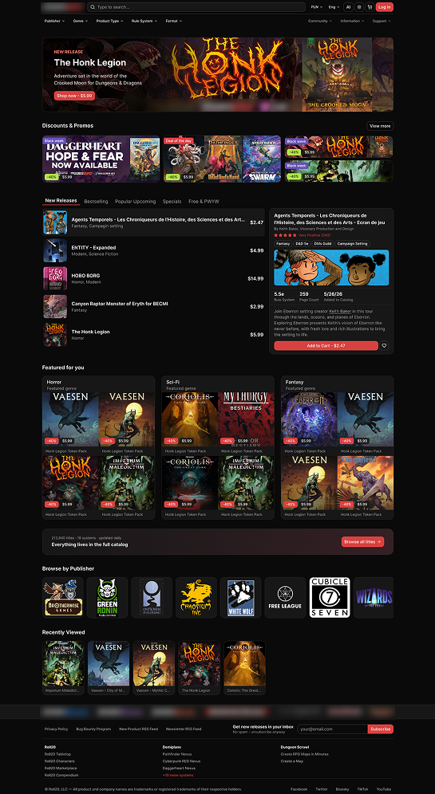
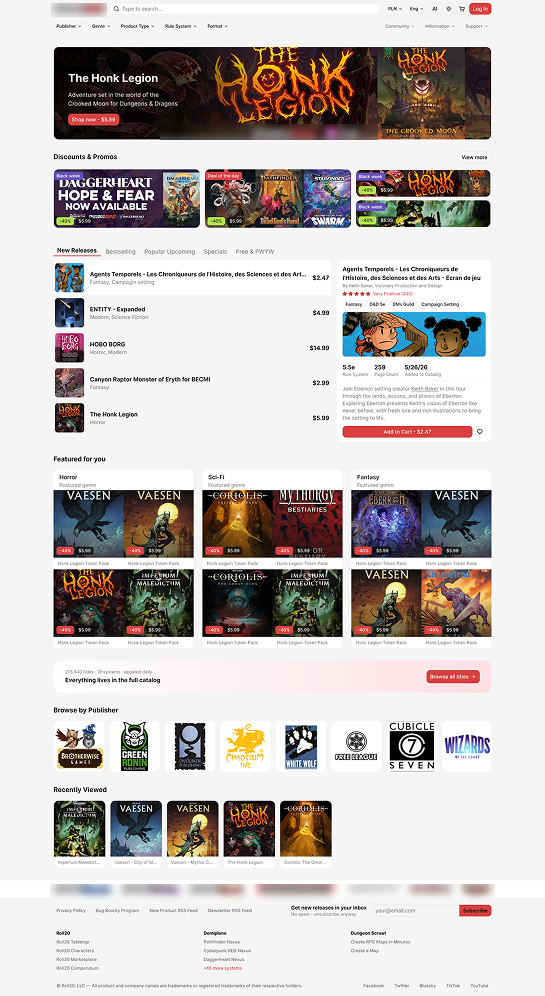

# DriveThruRPG Redesign

> **A UX/UI case study and working front-end prototype.**
> This is a portfolio project, **not a real store**. Nothing is for sale, no payments are processed and all data is made up. Not affiliated with or endorsed by DriveThruRPG, OneBookShelf or any publisher.

[](https://github.com/Yuka27/drivethrurpg-redesign/actions/workflows/ci.yml)

| Dark theme                                               | Light theme                                                |
| -------------------------------------------------------- | ---------------------------------------------------------- |
|  |  |

_Home page mockups from the Figma case study._

## Links

|                      |                                                                                        |
| -------------------- | -------------------------------------------------------------------------------------- |
| **Live prototype**   | <CLOUDFLARE_PAGES_URL>                                                                 |
| **Figma case study** | <FIGMA_URL> (research, audit, wireframes, mockups, design system)                      |
| **Mock API docs**    | <RENDER_URL>/docs (OpenAPI / Swagger UI)                                               |
| **Test coverage**    | https://yuka27.github.io/drivethrurpg-redesign/ (Vitest report, rebuilt on every push) |

> The mock API runs on a free hosting plan and sleeps when idle. The first request can take 30-60 seconds to wake it up.

## About the project

DriveThruRPG is the largest marketplace for tabletop roleplaying games, with a huge catalogue and a long history. Its core commerce (search, browse, cart, checkout) works, but the experience feels dated: visual inconsistency left by incremental changes, a mobile layout that reflows the desktop grid instead of being designed for phones, and filters that are split and incomplete.

This project redesigns that experience end to end, from research to a working app:

1. **Audit:** heuristic review of every key page (Home, Listing, Product, Cart, Library, Account) with findings, critical fixes and ideas.
2. **Design:** wireframes, mockups and a dark-first design system with a light theme, checked against WCAG AA contrast.
3. **Build:** a real React application backed by a mock API, so flows can be clicked through and tested, not only drawn.

### What you can explore

- **Home** with a hero carousel, promo tiles, a Steam-inspired tabbed main section (New, Bestselling, On sale, Free, plus a personal _Following_ tab when signed in), a preview panel with page samples and an edition picker, featured-for-you and publishers.
- **Listing** with unified filters, sorting and facet counts.
- **Product page** with editions, page samples, a PDF preview, reviews, discussions and follow options (publisher, imprint, rule system, genre, product line).
- **Cart and checkout**, **My Library**, **Wishlist**, **Following**, **Orders**, **Notifications**, **Account** and **Preferences**.
- **Two languages** (English and Polish), multiple currencies and a switch for AI-generated content.
- **Light and dark themes**, keyboard navigation and screen-reader labels throughout.

## Tech stack

### Front end

| Area                 | Tools                                                                               |
| -------------------- | ----------------------------------------------------------------------------------- |
| Framework            | React 19, TypeScript                                                                |
| Build tooling        | Vite+ (Vite, Vitest, Rolldown, Oxlint, Oxfmt)                                       |
| Routing              | TanStack Router                                                                     |
| Data fetching        | TanStack Query                                                                      |
| Client state         | Zustand                                                                             |
| Forms and validation | react-hook-form, Zod (also validates API responses)                                 |
| Internationalisation | i18next (English, Polish, plus an `en-XA` pseudo-locale for testing text expansion) |
| Styling              | Tailwind CSS v4, design tokens as CSS variables                                     |
| Components           | shadcn/ui (Radix primitives)                                                        |
| Testing              | Vitest, Testing Library                                                             |

### Mock API

| Area            | Tools                                                                         |
| --------------- | ----------------------------------------------------------------------------- |
| Server          | One dependency-free Node.js file (`server.js`, Node 18+), serving `/api/v1/*` |
| Data            | Generated JSON files, state kept in memory (resets on restart)                |
| Data generation | Python 3 scripts (Pillow for images)                                          |
| Contract        | OpenAPI 3.0.3 with Swagger UI at `/docs`                                      |
| Localisation    | Polish overlay applied per request through `Accept-Language`                  |

### Delivery

GitHub Actions (typecheck, lint, format, i18n check, tests, coverage), Cloudflare Pages (app), Render (mock API), GitHub Pages (coverage report).

### Design

Figma for research, wireframes, mockups and the design system; HTML prototypes for interaction ideas before implementation.

## Getting started

```bash
git clone https://github.com/Yuka27/drivethrurpg-redesign.git
cd drivethrurpg-redesign
npm install            # or the package manager / vp command this repo uses
cp .env.example .env   # set VITE_API_URL
npm run dev
```

By default the app talks to the hosted mock API. To use a local one, run it (see below) and set `VITE_API_URL=http://localhost:3000`.

| Variable                                                                      | Purpose                                                          |
| ----------------------------------------------------------------------------- | ---------------------------------------------------------------- |
| `VITE_API_URL`                                                                | Origin of the mock API (images and files are served from it too) |
| `VITE_FIGMA_URL`, `VITE_GITHUB_URL`, `VITE_API_DOCS_URL`, `VITE_COVERAGE_URL` | Links shown in the portfolio notice                              |
| `VITE_SHOW_PORTFOLIO_NOTICE`                                                  | Set to `false` to hide the first-visit notice (screenshots, e2e) |

### Scripts

| Command                 | What it does                                      |
| ----------------------- | ------------------------------------------------- |
| `npm run dev`           | Start the dev server                              |
| `npm run build`         | Production build into `dist/`                     |
| `npm run typecheck`     | TypeScript check                                  |
| `npm run lint`          | Lint                                              |
| `npm test`              | Run the tests                                     |
| `npm run test:coverage` | Tests with an HTML coverage report in `coverage/` |

## Deployment

The app is static files, hosted on **Cloudflare Pages**. In the Pages project settings:

| Setting                | Value                                                                         |
| ---------------------- | ----------------------------------------------------------------------------- |
| Framework preset       | None                                                                          |
| Build command          | `npm run build`                                                               |
| Build output directory | `dist`                                                                        |
| Node version           | 24 (from `.node-version`; or set `NODE_VERSION=24`)                           |
| Environment variable   | `VITE_API_URL` = the hosted mock API origin (no trailing slash, no `/api/v1`) |

- **Variables are baked in at build time.** Vite writes them into the files it builds, so changing `VITE_API_URL` (or any `VITE_` variable) only takes effect after a new deployment. A missing or invalid `VITE_API_URL` still builds, but the site then shows a "This build is not configured" screen naming the variable, instead of a blank page.
- **Deep links work without a `_redirects` file:** with no `404.html` in the output, Pages serves `index.html` for unknown paths and the router takes over. `public/_headers` caches the hashed files in `/assets/` for good and makes browsers check `index.html` on every visit.
- **The hosted mock API sleeps on the free plan.** After a while without visits, the first request can take 30–60 seconds while it wakes up; the app shows its loading outlines meanwhile.

## Mock API

The mock API imitates a real store back end: catalogue, search facets, cart and checkout, library, orders, follows, notifications and more (about 140 endpoints). Full reference: `<RENDER_URL>/docs`.

```bash
cd mock-api
node server.js         # http://localhost:3000/api/v1
```

Useful switches for testing the UI:

| Switch                       | Effect                                 |
| ---------------------------- | -------------------------------------- |
| `Accept-Language: pl`        | Polish text where a translation exists |
| `X-Currency: PLN`            | Prices in another currency             |
| `X-Ai-Content: show`         | Include AI-generated titles            |
| `X-Mock-User: guest`         | Signed-out experience                  |
| `?mock=slow` / `?mock=error` | Simulate slow responses and failures   |

Changes between versions are listed in `mock-api/CHANGES.md`.

## Quality

- **Tests:** unit and component tests with Vitest and Testing Library, with the coverage report linked above.
- **Accessibility:** WCAG AA colour contrast on tokens, visible focus, real buttons and links, labelled icons, reduced-motion support.
- **Internationalisation:** all text goes through translation keys; an automated check catches missing keys, and the `en-XA` pseudo-locale makes untranslated text easy to spot.
- **Type-safe API boundary:** every API response is parsed with Zod, so a mismatch between the API and the UI fails loudly.

## Disclaimer

This project is for portfolio and educational purposes only. DriveThruRPG and all product names, covers, logos and publisher names are the property of their respective owners and are used here for demonstration only. If you are a rights holder and want something removed, please open an issue.

## Author

Designed and built by **theNoy** ([GitHub](https://github.com/Yuka27)).
